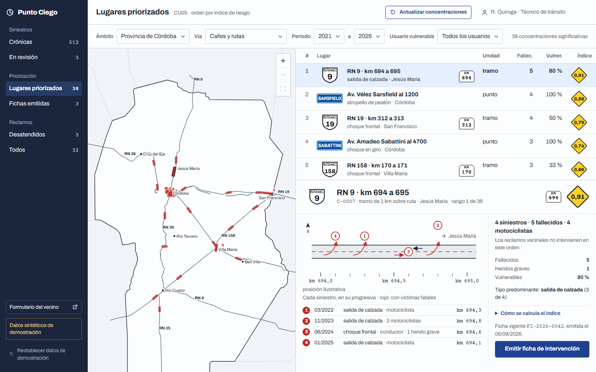
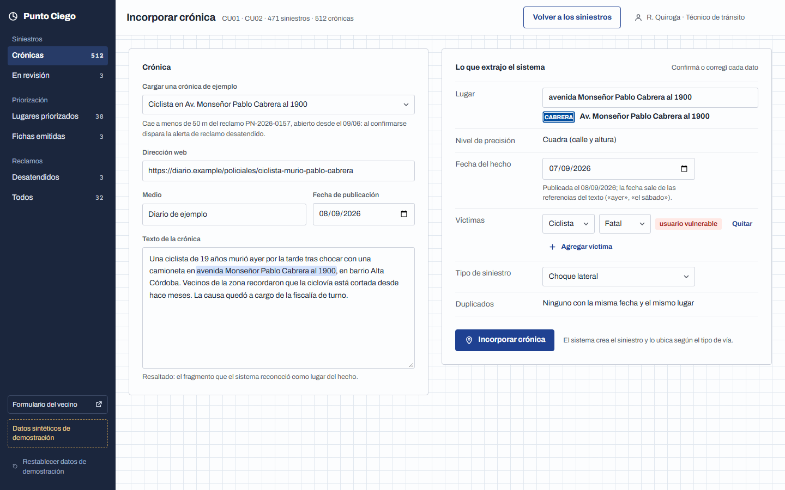
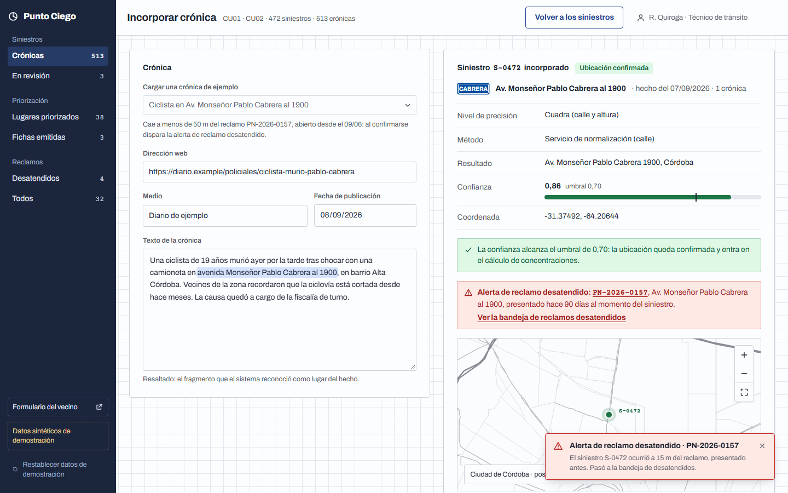
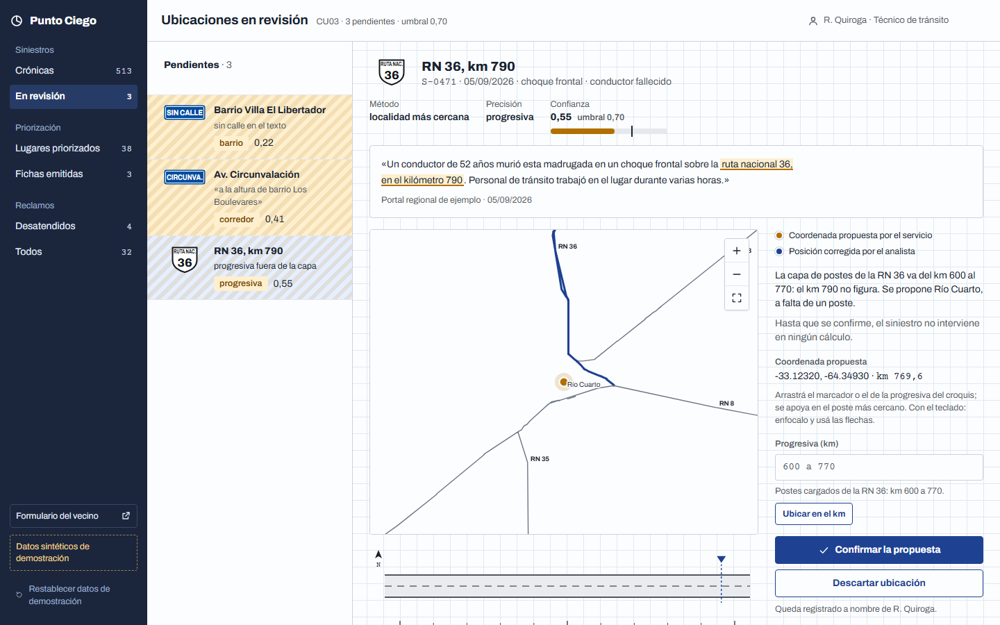
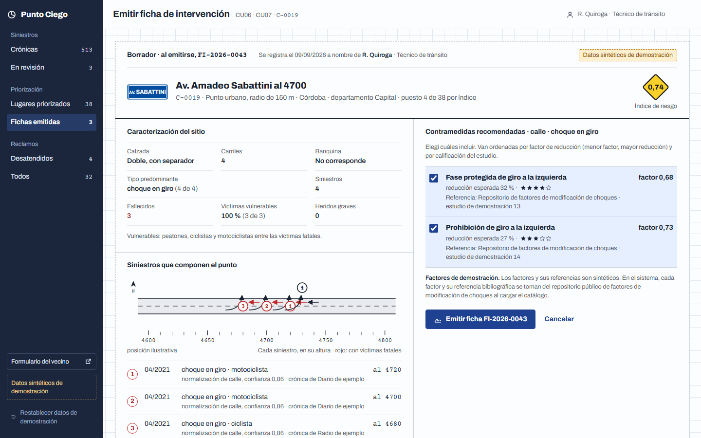
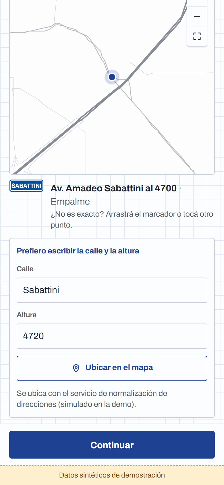
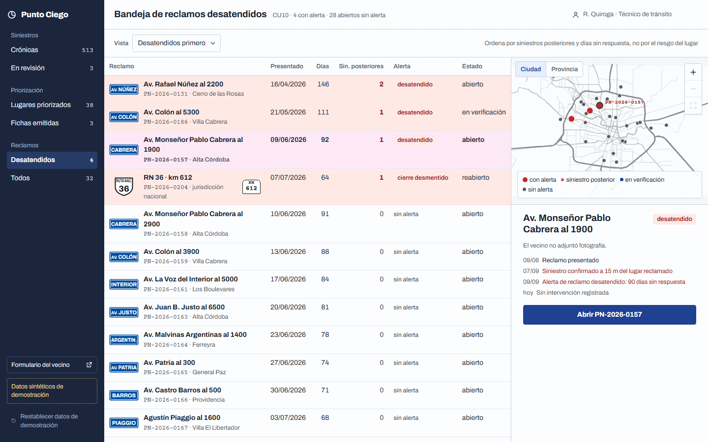
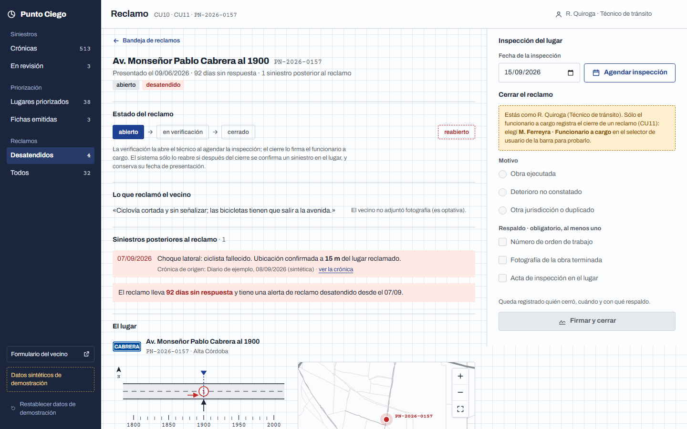

# Punto Ciego

**Sistema de priorización de puntos negros viales y alerta de reclamos desatendidos.**

Prototipo del Trabajo Final de Grado de Ingeniería en Software · Universidad Siglo 21 ·
2026 · José Paulino Da Luz Pereira · Tutora: Ing. Julieta Rabozzi



## El problema

En la provincia de Córdoba, los organismos publican cuántas personas mueren en el
tránsito, pero no **dónde**. La ubicación de cada siniestro sólo existe descrita en el
texto de las crónicas periodísticas («en avenida Sabattini al 4700», «en el kilómetro 214
de la ruta 158»). Sin ese dato, las obras sobre la vía se deciden por reclamo vecinal o
por criterio, y ningún lugar puede compararse con otro según su riesgo.

Punto Ciego reconstruye esa ubicación y la convierte en una decisión: **qué lugar
intervenir primero, con qué medida y con qué respaldo**, y avisa cuando un vecino había
advertido el peligro y nadie respondió antes de que ocurriera un siniestro.

## Probalo ahora, sin instalar nada

### https://punto-ciego-zeta.vercel.app

- Funciona en cualquier navegador actualizado, en la computadora o en el teléfono.
- No pide registrarse. Los datos son **sintéticos de demostración** (siniestros, reclamos
  y fichas de ejemplo de la provincia de Córdoba) y se guardan sólo en tu navegador.
- Podés probar todo sin miedo a romper nada: el botón **Restablecer datos de
  demostración**, al pie del menú lateral, vuelve al estado inicial.
- El usuario de arriba a la derecha cambia el rol con el que trabajás (ver
  [Usuarios de demostración](#usuarios-de-demostración)).

También hay un **video de la demostración** (unos 12 minutos, narrado) en la
[carpeta de la entrega](https://drive.google.com/drive/folders/1h6gJafeSdBVx3QS7ACGtBTXZHZjTLiQQ).

## Recorrido sugerido (10 minutos)

Este recorrido sigue la cadena completa del sistema, de la noticia a la obra.

**1. Ubicar un siniestro a partir de una crónica.** En el menú, *Crónicas* → *Incorporar
crónica*. Elegí la crónica de ejemplo «Ciclista en Av. Monseñor Pablo Cabrera al 1900».
El sistema extrae del texto el lugar, la fecha, las víctimas y el tipo de siniestro, y
resalta el fragmento que reconoció como lugar.



**2. Ver la alerta.** Presioná *Incorporar crónica*. El sistema ubica el siniestro con
una confianza de 0,86 y descubre que a 15 metros había un reclamo vecinal presentado 90
días antes y sin respuesta: emite la **alerta de reclamo desatendido**.



**3. Revisar una ubicación dudosa.** En *En revisión*, elegí «RN 36, km 790». La crónica
menciona un kilómetro que no figura en la capa de postes de esa ruta, así que el sistema
no lo usa en ningún cálculo hasta que un técnico lo revise. Escribí la progresiva
`700,5`, presioná *Ubicar en el km* y *Confirmar posición corregida*.



**4. Priorizar.** En *Lugares priorizados* está la respuesta a la pregunta central:
dónde intervenir primero. El mapa muestra las concentraciones de siniestros de la
provincia y la lista las ordena por un **índice de riesgo** (severidad, frecuencia y
proporción de peatones, ciclistas y motociclistas). Probá los filtros (por ejemplo,
*Sólo rutas*), acercá el mapa y elegí un lugar para ver su croquis; *Cómo se calcula el
índice* muestra la cuenta.

**5. Emitir la ficha de intervención.** Elegí «Av. Amadeo Sabattini al 4700» y
presioná *Emitir ficha de intervención*. La ficha reúne la caracterización del sitio,
los siniestros que lo componen y las **contramedidas recomendadas**, cada una con su
factor de reducción y su referencia.



**6. Reclamar como vecino.** *Formulario del vecino* abre lo que vería un vecino desde
el teléfono (conviene achicar la ventana). Sin cuenta ni datos personales: dónde es y qué
pasa. Probá «Prefiero escribir la calle y la altura» con Sabattini 4720.



**7. Atender la alerta.** En *Desatendidos* está la bandeja de reclamos, ordenada por
los siniestros que ocurrieron después de cada reclamo y por los días sin respuesta. Abrí
PN-2026-0157, agendá la inspección y después cambiá el usuario a **M. Ferreyra ·
Funcionario a cargo** para cerrarlo: elegí *Obra ejecutada*, marcá el número de orden de
trabajo y firmá.





## Qué hace el sistema

| Función | Para qué sirve |
|---|---|
| Incorporar crónicas | Convierte una noticia en un siniestro registrado: lugar, fecha, víctimas y tipo |
| Ubicar en calle y en ruta | En la ciudad usa calle y altura; en ruta, el kilómetro sobre los postes de la red vial |
| Reconocer hechos repetidos | Si dos medios cuentan el mismo siniestro, se vinculan y no se cuenta dos veces |
| Revisar ubicaciones dudosas | Lo que no alcanza la confianza mínima no entra en ningún cálculo hasta que una persona lo revise |
| Priorizar los lugares | Encuentra las concentraciones de siniestros que no son casualidad y las ordena por riesgo |
| Emitir la ficha de intervención | Propone la medida para cada lugar, con su respaldo, para que decida el funcionario |
| Recibir el reclamo del vecino | Desde el teléfono, sin cuenta y sin datos personales |
| Alertar el reclamo desatendido | Avisa cuando, después de un reclamo, hubo un siniestro en el mismo lugar |
| Cerrar con respaldo | Sólo el funcionario a cargo cierra un reclamo, y con una prueba verificable; si después hay otro siniestro, se reabre |

## Usuarios de demostración

| Usuario | Rol | Qué puede hacer |
|---|---|---|
| R. Quiroga | Técnico de tránsito (el usuario inicial) | Todo lo de la lista, salvo cerrar reclamos |
| M. Ferreyra | Funcionario a cargo | Todo, incluido cerrar reclamos con su firma |
| L. Ahumada | Analista de siniestralidad | Incorporar crónicas, revisar ubicaciones y consultar |

## Correrlo en tu computadora

Si preferís ejecutarlo localmente en lugar de usar la versión en línea, sólo hace falta
[Node.js](https://nodejs.org) 20 o posterior.

```bash
git clone https://github.com/josedaluzp/punto-ciego.git
cd punto-ciego/prototipo
npm install
npm run dev
```

Después abrí **http://localhost:5173** en el navegador. No hace falta base de datos,
servidor ni configuración: la aplicación corre por completo en el navegador.

## Comprobar que todo funciona (opcional)

Para usar la aplicación no hace falta nada de esto. Esta sección es para quien quiera
verificar, de forma automática, que cada función hace lo que promete. Se ejecuta desde
`prototipo/`.

**Pruebas unitarias.** Más de 230 pruebas que comprueban las reglas del sistema sin
abrir ninguna pantalla: que una progresiva de ruta se ubique en el kilómetro correcto,
que una concentración sólo cuente si supera la prueba estadística, que la alerta se
emita únicamente cuando el siniestro es posterior al reclamo, etcétera.

```bash
npm run test
```

**Pruebas de punta a punta.** Simulan a una persona usando la aplicación: un navegador
automatizado ([Playwright](https://playwright.dev)) abre cada pantalla y hace los clics y
las escrituras de cada caso de uso, en tamaño de computadora y de teléfono, y verifica el
resultado. Por eso, la primera vez, hay que descargar ese navegador de prueba (Chromium);
no es el navegador con el que se usa la app.

```bash
npx playwright install chromium   # sólo la primera vez
npm run e2e
```

La carpeta [`validacion/`](validacion/) hace lo mismo desde afuera: recorre la versión
publicada en línea y comprueba que los enlaces de la entrega estén disponibles.

## Cómo está hecho

Aplicación web en **TypeScript** con **React**, compilada con **Vite**. Las reglas del
sistema (extracción del texto, ubicación, concentraciones, índice de riesgo,
contramedidas, alertas y cierre) están separadas de las pantallas, en
`prototipo/src/dominio`, y tienen sus propias pruebas.

El documento del trabajo diseña el sistema completo con un servidor en Python y una base
de datos PostgreSQL. Este prototipo ejecuta las mismas reglas en el navegador, con datos
de demostración, para poder probarse sin instalar un servidor. El
[README del prototipo](prototipo/README.md) detalla la arquitectura, los casos de uso que
cubre cada pantalla y los datos de demostración.

## Contenido del repositorio

| Carpeta | Qué contiene |
|---|---|
| [`prototipo/`](prototipo/) | La aplicación, con sus pruebas y su documentación técnica |
| [`video/`](video/) | El proyecto que arma el video de la demostración ([cómo se genera](video/README.md)) |
| [`validacion/`](validacion/) | Pruebas que recorren la versión publicada y los enlaces de la entrega |
